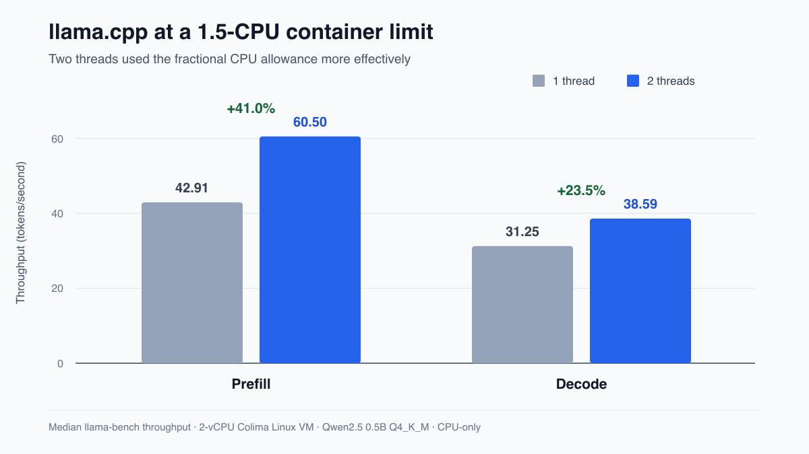

# llama.cpp cgroup CPU investigation

This repository records an independent reproduction and review of [llama.cpp issue #30070](https://github.com/ggml-org/llama.cpp/issues/30070) and [PR #30267](https://github.com/ggml-org/llama.cpp/pull/30267). It deliberately uses upstream `llama-bench`; it does not introduce another benchmark tool.

## Key result

The proposed upstream fix correctly limits default threads for integral cgroup
CPU quotas. At a fractional 1.5-CPU quota, however, integer division selects one
thread and leaves measurable capacity unused.

Using two threads instead of one improved median prompt-processing throughput
from 42.91 to 60.50 tokens/s (+41.0%) and generation throughput from 31.25 to
38.59 tokens/s (+23.5%). A focused follow-up using ceiling division selected two
threads at 1.5 CPUs while preserving the tested selections at 0.5, 1, and 2
CPUs.

The experiment contains 460 raw measurements across 46 CPU-only configurations.
It ran in a two-vCPU Colima Linux VM, so the result demonstrates this
fractional-quota edge case rather than universal CPU performance. The main fix
belongs to the existing upstream PR; no upstream acceptance is claimed.

Start with:

- `research/final-report.md` — conclusion and recommendation
- `research/upstream.md` — mandatory upstream stop/go review
- `results/pr-comparison.md` — numerical comparison and edge-case status
- `results/environment.md` — exact environment and limitations
- `results/runs.csv` — 460 raw samples
- `contribution/0001-common-round-fractional-cgroup-quotas-up.patch` — focused follow-up to the existing PR
- `research/critical-review.md` — risks, corrections, and public-run stop/go criteria

The recommendation is **UPSTREAM FIX**: share the fractional-quota evidence and patch on the existing PR rather than opening a duplicate implementation.

## Public Linux verification

The independent [GitHub-hosted Linux verification run](https://github.com/kraftaa/llama-cpp-cgroup-threading/actions/runs/43515926992)
completed successfully on 2026-11-13. On the four-vCPU x86 runner, the focused
follow-up selected two threads at a 1.5-CPU quota and improved median throughput
over the PR's one-thread default by 43.2% for prompt processing and 27.4% for
token generation. All eight thread-selection checks passed. The run page
contains a downloadable evidence artifact with the environment record, raw
logs, normalized samples, summary, and stop/go verdict.

The `Linux cgroup reproduction` workflow is intentionally manual-only. Its
default five repetitions build the pinned PR parent, PR, and fractional
follow-up, download and checksum the pinned model, run a narrow CPU-only matrix,
and upload raw logs plus `ci-verdict.md`.

Making the repository public does not itself start the workflow. Do not add a
schedule or push trigger: this is a one-time independent evidence run, not a
general benchmark service or a stable performance CI suite.

The workflow uses the standard `ubuntu-24.04` runner. GitHub documents standard
hosted runners as free and unlimited for public repositories; artifact storage
still follows the account's storage policy. Only small text/CSV evidence is
uploaded—the model and Docker images are not retained as artifacts.
